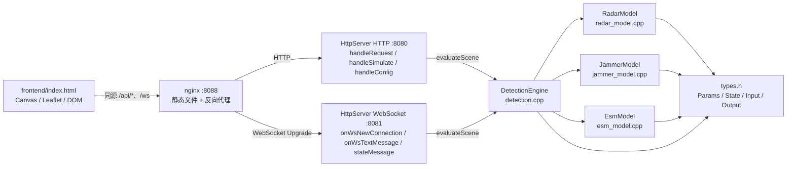

# 雷达对抗仿真扩展与维护指南

> 读者：后续接手本项目的开发者。
>
> 目标：在不破坏现有分层的前提下，知道到哪里加代码、复用哪些扩展点，以及哪些实现是演示用的简化版本。
>
> 先说明命名差异：本项目前端实际文件是 `frontend/index.html`（早期文档中的 `web/index.html` 已重命名）；WebSocket 服务端逻辑目前在 `src/http_server.cpp` 中，没有独立的 `ws_server.cpp`；干扰策略接口目前叫 `IJammerStrategy::evaluate()`，不是 `computeJSEffect()`；前端动画函数叫 `draw()`，没有 `render()`。下文一律使用项目中的真实名称。需求中提到的 `latestResult` 对应前端的 `state.result`。

## 一、架构总览与分层约定

### 1.1 模块依赖图



`nginx` 只负责静态页面和转发，不属于业务分层。后端没有单独的“WS 服务类”：`HttpServer` 同时继承 `QTcpServer` 并持有一个 `QWebSocketServer`，见 `src/http_server.h` 和 `src/http_server.cpp`。如果后续把 WS 拆成 `WsServer`，应保持图中的依赖方向，不要让 WS 层依赖 HTTP 层。

### 1.2 三条架构红线

**红线一：物理层零 Qt 依赖。**

以下文件只能 include 标准库、项目内头文件：

```text
src/types.h
src/jammer_strategy.h
src/radar_model.h / .cpp
src/jammer_model.h / .cpp
src/esm_model.h / .cpp
src/detection.h / .cpp
```

它们不能出现 `QString`、`QObject`、`QJson*`、`Q_OBJECT`，也不能 include 任何 `Q...` 头文件。`SimOutput::status` 和 `JammerParams::strategy` 使用 `std::string`，这是为 FT-2000/麒麟移植保留的。

**红线二：通信层只做 JSON 与结构体转换、请求路由。**

`src/http_server.cpp` 可以做：

- 解析 HTTP 行、Header、Body；
- 调用 `applySimInput()` / `applyConfigJson()` 把 JSON 写入 `SimInput` / `SimConfig`；
- 调用 `DetectionEngine::evaluateScene()`；
- 用 `sceneToJson()` / `resultToJson()` 生成响应。

它不能出现 `R0`、`J/S`、`R_eff` 的计算公式。物理量只能来自 `DetectionEngine` 的返回值。未来新增的 `ws_server.cpp` 同样如此。

**红线三：前端负责平台位置与参数编辑、运动学和渲染，但不计算物理结论。**

当前 `frontend/index.html` 允许编辑雷达、目标、干扰机的绝对本地坐标（km），以及雷达参数（`Pt`、`Gt`、`lambda`、`Pmin`、`loss`）和干扰机参数（`Pj`、`Gj`、`js_threshold_db`、`strategy`）；也可以通过拖动地图标记、拖动 PPI 目标或点击地图改变位置。`sceneFromControls()` 每次组装完整场景（`radar`、`jammer`、`target`、`radar_position`、`jammer_position`、`esm_on`、`jammer_on`），`queueSend()` 通过 WebSocket 发给后端，后端返回 `state.scene` / `state.result`。坐标换算、运动学、拖尾和 PPI 扫描都在前端完成；前端不能自行计算 `target_detected`、`status`、`R_eff`、`R_target`、`R_jammer` 等物理结论，也不能自行“猜”一个探测结果。

**坐标约定**：场景统一使用本地平面直角坐标，单位为米，`x` 向东、`y` 向北，原点由地图工具栏的“地图原点 WGS84”决定。`radar_position`、`target.x/y`、`jammer_position` 都是同一坐标系下的绝对位置，不能把目标坐标理解成“相对雷达的距离/方位”。后端在 `detection.cpp` 中计算：

```text
R_target = hypot(target - radar_position)
R_jammer = hypot(jammer_position - radar_position)
```

`jammer_position_valid=false` 时后端回退为 `R_jammer = R_target`，保留旧版“干扰机随目标”的自卫干扰几何。HTTP/WS 的 `applySimInput()` 还做了兼容：请求只带 `target`、不带 `jammer_position` 时，自动把干扰机放到目标位置并置 `jammer_position_valid=true`；因此旧 curl 请求和旧前端仍得到与之前相同的 J/S。若请求显式提供 `jammer_position`，则 `x`、`y` 必须同时存在，否则返回 400。前端默认干扰机位于 `(15 km, 20 km)`，与默认目标 `(20 km, 15 km)` 同距不同方位，默认 J/S 不变且地图标记不会重叠。

### 1.3 为什么这样分层

- **物理层可移植**：`radar_core` 不链接 Qt，只有 `radar_sim` 可执行文件链接 Qt；物理代码可原样复制到 FT-2000/麒麟，也便于独立测试。
- **通信层可替换**：`DetectionEngine` 不知道请求来自 `handleSimulate()` 还是 `onWsTextMessage()`，换传输方式不需要改物理公式。
- **前端可独立迭代**：交互和动画修改不需要重编后端，前端只需遵守 WS 消息结构和 API 路径。

## 二、常见扩展场景的加代码指南

### 场景 1：增加一种新的干扰类型（欺骗干扰、距离拖引）

**现状扩展点**：`src/jammer_strategy.h` 已经定义了 `IJammerStrategy`，现有噪声压制实现 `NoiseJamStrategy` 在 `src/jammer_model.cpp` 的匿名命名空间中；`JammerModel::evaluate()` 通过 `strategyRegistry()` 和 `findJammerStrategy()` 分派。`JammerParams::strategy` 是字符串注册名，已经能从 JSON 传入。

**加代码方式**：

1. 新增 `src/deception_jammer.h/.cpp` 和 `src/rgpo_jammer.h/.cpp`，分别定义：

   ```cpp
   class DeceptionJamStrategy final : public IJammerStrategy {
   public:
       std::string name() const override { return "deception"; }
       JammerEffect evaluate(const RadarParams &, const JammerParams &,
                             double rcsM2, double targetRangeM,
                             double jammerRangeM,
                             double baseRangeM) const override;
   };
   ```

   `RGPOStrategy` 同理，注册名建议用 `"rgpo"`。
2. 在 `src/jammer_model.cpp` 的 `strategyRegistry()` 中登记静态实例：

   ```cpp
   static const DeceptionJamStrategy deception;
   static const RGPOStrategy rgpo;
   static const std::map<std::string, const IJammerStrategy *> registry{
       {noise.name(), &noise},
       {deception.name(), &deception},
       {rgpo.name(), &rgpo},
   };
   ```

3. 如果新策略需要参数（例如拖引速率、假目标延迟），在 `src/types.h` 的 `JammerParams` **末尾追加字段**，并在 `src/http_server.cpp` 的 `applyConfigJson()` / `jammerToJson()` 中补 JSON 映射。不要改动已有字段的顺序或含义。
4. `DetectionEngine::evaluateSingleRadar()` 不需要改。当前 `JammerModel::evaluate()` 已经按 `JammerParams::strategy` 分派，加策略只改注册表。新策略的 `evaluate()` 会同时收到 `targetRangeM` 与 `jammerRangeM`；需要距离几何时自行使用，不能假设 `R_j = R_t`，否则支援干扰场景会算错。
5. 如果要增加枚举 `JammerMode`，把它作为 `strategy` 的类型安全视图追加到 `JammerParams`，同时保留 `strategy` 字符串作为 JSON 规范字段；不要删掉 `strategy`，否则现有前端和配置会失效。也不要在 `detection.cpp` 增加按枚举分支的物理逻辑。
6. 前端：`frontend/index.html` 的 `<select id="strategyInput">` 已有 `deception`、`rgpo` 占位项（当前 `disabled`）。实现后端策略后去掉 `disabled`，`sceneFromControls()` 会自动发送 `jammer.strategy`，`syncControlsFromScene()` 会自动回填。若新策略有专属参数，在控件区增加输入并在 `sceneFromControls()` 中组装到 `jammer`，其余流程不动。
7. 测试：直接构造 `JammerModel` 调用 `evaluate()`，覆盖非法输入、缺失策略名回退到 `noise`、正常策略结果。

**不能改的部分**：`src/radar_model.cpp`、`src/esm_model.cpp` 的物理公式；`src/detection.cpp` 中的 `J/S` 判定和 `status` 判定顺序；通信层只允许增加 JSON 字段映射，不能写干扰公式。需求中的“在 `jammer_model.h` 定义接口、把噪声逻辑抽成 `NoiseJamStrategy`”在当前代码中已经完成，不要重复造第二套接口。

### 场景 2：雷达模型升级（大气衰减、地物杂波、多普勒滤波损失）

**保持接口**：`RadarModel::computeR0(const RadarParams&, double rcsM2)` 的签名和“自由空间基准”语义不变。现有 `computeAtmosphericLoss(double rangeM)` 是预留扩展点，`baseDetectionRange()` 已按 `R = R0 / L(R)^(1/4)` 迭代求解。大气衰减加在这里，不要把距离相关衰减塞进 `computeR0()`，否则基准值和单测都不稳定。

**加代码方式**：

1. 在 `src/radar_model.h` 增加：

   ```cpp
   double computeAtmosphericLoss(const RadarParams &radar, double rangeM) const;
   double computeClutterLoss(const RadarParams &radar,
                             const EnvironmentParams &env) const;
   ```

   保留现有的单参数 `computeAtmosphericLoss(double)` 作为兼容重载，内部转调带参数版本。
2. 在 `src/types.h` 增加环境参数。优先新增：

   ```cpp
   struct EnvironmentParams {
       double atmosphere_db_per_km = 0.0; // 单程衰减
       double clutter_loss_db = 0.0;
   };
   ```

   然后把它**追加**到 `SimInput`（以及需要时的 `SimConfig`）。如果团队坚持放在 `RadarParams`，也只能在末尾追加，不能让已有解析代码和前端数据失效。
3. `computeAtmosphericLoss()` 返回双程线性功率损耗，例如 `L = 10^((2 * alpha_db_per_km * range_km) / 10)`；`baseDetectionRange()` 继续用原来的迭代，自动得到新的有效距离。
4. `computeClutterLoss()` 与大气损耗相乘后作为 `baseDetectionRange()` 的总损耗；多普勒滤波损失可作为另一个乘性损耗，或作为 `RadarParams` 的附加字段。不要把杂波损耗直接写成 `R0 * factor`。
5. 配置链路：`src/http_server.cpp` 的 `applyConfigJson()` 读取新增环境字段，`configToJson()` / `sceneToJson()` 输出新增字段；不要修改已有 JSON 字段名。
6. 测试：`computeR0()` 仍应等于自由空间公式；`baseDetectionRange()` 在 `atmosphere_db_per_km = 0`、`clutter_loss_db = 0` 时必须与旧值一致；打开衰减后距离变小，并验证迭代收敛。

**不能改的部分**：`types.h` 中 `SimInput` / `SimOutput` 的已有字段（只能追加，不能删除或改变单位）；`detection.cpp` 的判定顺序；通信层不出现损耗公式，只做字段映射。

### 场景 3：多目标支持

**注意**：直接把 `SimInput::target` 替换为 `targets` 会破坏 HTTP JSON、WS 场景和前端，建议分两步：先新增 `targets` 并保留 `target`，确认没有旧调用方后再移除。

**加代码方式**：

1. 在 `src/types.h` 追加：

   ```cpp
   struct TargetResult {
       double R_target = 0.0;
       double R_eff = 0.0;
       double js_ratio_db = -999.0;
       bool esm_detected = false;
       bool target_detected = false;
       std::string status = "NORMAL";
   };
   ```

   `SimInput` 保留 `TargetState target`，追加 `std::vector<TargetState> targets`；`SimOutput` 保留现有单目标字段，追加 `std::vector<TargetResult> results`。这样旧前端和旧 curl 请求还能工作。
2. 在 `src/detection.cpp` 抽出“单目标评估”：

   ```cpp
   TargetResult evaluateSingleTarget(const RadarParams &radar,
                                     const JammerParams &jammer,
                                     const TargetState &target,
                                     bool esmOn, bool jammerOn) const;
   ```

   把当前 `evaluateSingleRadar()` 中 `R_target`、`R_jammer`、`R0`、`R_eff`、`esm_detected`、`target_detected`、`status` 的逻辑原样搬进去；`evaluateSingleRadar()` 变成“包装单个 `input.target`”的兼容函数。若保留独立干扰机，签名还必须带上 `radar_position` 与 `jammer_position`（或已求出的 `R_target` / `R_jammer`），不能只传 `target`，否则支援干扰几何会丢失。
3. `evaluateScene()` 内部循环：`targets` 非空时逐个调用 `evaluateSingleTarget()` 并填入 `results`；否则调用一次旧逻辑。**单目标的物理判定只能复用，不能在循环里复制第二份公式。**
4. 通信层：`src/http_server.cpp` 的 `applySimInput()` 同时接受旧 `target` 和新 `targets`，`sceneToJson()` / `resultToJson()` 同时输出两种形状；新接口建议明确使用 `{"targets":[...]}` 和 `{"results":[...]}`。为了兼容，可在响应中保留旧的顶层 `R0`、`R_eff` 等字段，表示第一个目标或聚合值，但要在 API 文档中写清楚。
5. 前端 `frontend/index.html`：把 `state.scene.target` 的读取改为数组驱动，增加 `activeTargetIndex`；`drawTarget()`、`updateMap()` 用 `forEach` 渲染多个目标；地图 marker、PPI 目标点、控制面板都按数组索引操作。目标参数编辑仍由前端产生，发给后端。
6. 测试：一个目标时结果与旧版逐字段一致；两个目标时每个目标独立计算 `R_eff` 和 `status`；空数组时有明确默认行为。

**不能改的部分**：现有单目标探测公式和 `evaluateSingleTarget()` 内部的物理逻辑；通信层循环只负责解析/序列化。需求中“`SimOutput` 改为每个目标一个 `TargetResult`”如果直接删除旧字段，会破坏兼容性，建议先追加 `results`，确认调用方迁移后再清理。

### 场景 4：多雷达组网

**加代码方式**：

1. 在 `src/types.h` 新增（或放在新的 `src/scene_types.h`）：

   ```cpp
   struct Scene {
       std::vector<RadarParams> radars;
       std::vector<TargetState> targets;
       EnvironmentParams environment;
   };

   struct NetworkResult {
       std::vector<TargetResult> targets; // 每个目标对全网的聚合结果
   };
   ```

   上面的结构只表达聚合层级；真正落地时，每部雷达必须带自己的 `Position2D position`，每个干扰机也必须带 `Position2D position` 和 valid 标志。否则 `evaluateNetwork()` 无法分别计算 `R_target` / `R_jammer`，也不能把一个 `SimInput::jammer_position` 复用给所有雷达。

2. `src/detection.cpp` 新增 `NetworkResult evaluateNetwork(const Scene &scene) const`；对每部雷达、每个目标复用场景 3 的单目标逻辑，再按目标聚合：任一雷达探测到即 `target_detected = true`，ESM 取并集，`status` 使用统一的“丢失 > 受扰 > ESM > 正常”优先级，不能在每个雷达分支各写一套。
3. 通信层新增 `applySceneJson()`，接受 `radars` 数组和 `targets` 数组；单雷达旧请求在入口处归一化成 `Scene{radars={input.radar}, targets={input.target}}`。`http_server.cpp` 只做归一化、调用 `evaluateNetwork()` 和把 `NetworkResult` 转回 JSON。
4. 前端 `frontend/index.html` 为每部雷达维护 marker 和 `R0`/`R_eff` 圆；每部雷达的探测圈用不同颜色或编号，目标状态取聚合结果。雷达、目标、干扰机的绝对位置仍由前端场景驱动，后端只计算各自到雷达的几何关系。
5. nginx 不需要改：如果新接口仍在 `/api/` 下，现有 `location /api/` 已经代理。

**不能改的部分**：`evaluateSingleRadar()` / `evaluateSingleTarget()` 的单雷达单目标判定；`RadarModel`、`JammerModel`、`EsmModel` 的公式；通信层不得自行聚合物理结果之外的规则。

### 场景 5：新增仿真接口（历史探测记录、参数扫描）

**加代码方式**：

1. 在 `src/http_server.cpp` 的 `handleRequest()` 中增加路由分支，例如：

   ```cpp
   if (target == QByteArrayLiteral("/api/history")) {
       if (method == "GET") handleHistory(socket, requestHead);
       ...
   }
   if (target == QByteArrayLiteral("/api/sweep")) {
       if (method == "POST") handleSweep(socket, requestHead, body);
       ...
   }
   ```

   同时把新方法加入 `sendResponse()` 的 CORS 允许列表，并为 `OPTIONS` 返回 204。
2. 新增 `src/history_store.h/.cpp`：用 `std::deque<HistoryRecord>` 保存有限条记录，外层用 `QMutex` 保护；记录只放 `DetectionEngine` 已算出的结果，不放公式。记录量很小时也可先放在 `HttpServer` 成员里，但接口要独立。
3. `handleSweep()` 只做：解析范围 → 校验上限 → 构造 `SimInput` → 调用 `DetectionEngine::evaluateScene()` → 组装二维数组，不写 `R0`/`J/S` 公式。
4. 扫描可能阻塞 Qt 事件循环。先限制网格点数（如不超过 100×100），超过阈值返回 400，或移到 `QThread` / `QtConcurrent` 后把结果发回主线程；不要让请求卡住 WS 广播定时器。
5. 新接口若不在 `/api/` 前缀下，才需要改 `docs/deploy/nginx/radar_sim.conf`；放在 `/api/` 下时 nginx 无需变更。

**不能改的部分**：物理层公式；`broadcastState()` 的实时推送语义；新接口只负责参数解析、调用和结果序列化。历史记录是旁路数据，不能反向改变当前场景，除非明确设计成“回放”接口。

### 场景 6：前端视觉增强（PPI 余晖、干扰波纹、目标航迹拖尾）

**实际文件**：`frontend/index.html`。早期文档中的 `web/index.html` 已迁移到这里。

**加代码方式**：

1. 余晖：只改 `drawSweep(time)` 和 `draw()`。当前 `draw()` 每帧 `clearRect` 后重绘；余晖需要单独维护一个离屏 canvas，按帧衰减透明度，而不是修改后端结果。
2. 干扰波纹：从 `state.scene.jammer_on` 和 `state.result.js_ratio_db` 取输入。当前 `draw()` 中的受扰环形区域由 `state.result.R_eff < state.result.R0` 驱动，波纹可在此基础上加时间相位。
3. 目标拖尾：在 `ws.onmessage` 收到新 `state.scene` 时，把目标位置追加到前端环形数组（例如最多 100 点）；`drawTarget()` 读取该数组绘制渐隐线段。不要在拖尾中改变 `state.result`。
4. 所有视觉元素必须由 `state.scene` / `state.result` 驱动。`state.result` 就是需求中的 `latestResult`；后端每 50 ms 广播一次，前端可按 60 fps 插值，但不能用插值结果覆盖真实读数。
5. 若确实需要新字段，先在 `resultToJson()` 中追加（如 `burn_through_range_m`），前端按可选字段处理并做降级。

**不能改的部分**：`src/http_server.cpp` 及物理层（除非新增只读字段）；前端不计算探测判决、不复制后端公式。需求中的“只改前端”在纯视觉增强时成立；一旦需要新物理量，就必须按“先追加字段、再消费”的顺序改后端。

## 三、待优化项清单

### P0（影响演示正确性，尽快做）

**P0-1 侦察截获模型过于简化**

- 当前实现：`src/esm_model.cpp` 的 `EsmModel::interceptionRangeM()` 返回 `baseRangeM * 1.2`，`canIntercept()` 判断 `targetRangeM < range`，没有 ESM 功率/增益/灵敏度参数。
- 理想实现：新增 `EsmParams { P_esm, G_esm, Pmin_esm, L_esm }`（波长可复用 `RadarParams::lambda`），在 `EsmModel` 中计算单程侦察距离，并按 `R_target < R_esm` 判定。
- 改动位置：`src/esm_model.h/.cpp` 的 `interceptionRangeM()` / `canIntercept()`；`src/types.h` 追加 `EsmParams` 和 `SimInput` 字段；`src/detection.cpp` 调用点；`src/http_server.cpp` 的 JSON 映射。
- 预估工作量/风险：约 0.5 天；风险是增益、波长和灵敏度单位不一致，容易混用单程/双程公式，必须补边界单测。

**P0-2 压制模型缺少烧穿距离**

- 当前实现：`src/jammer_model.cpp` 的 `NoiseJamStrategy::evaluate()` 先按支援干扰公式计算 `J/S = Pj*Gj*4*pi*R_t^4 / (Pt*Gt*sigma*R_j^2)`；当 `J/S > threshold` 时按 `R_eff = R0 / (1 + excess/10)^(1/4)` 缩小，`detection.cpp` 只比较 `R_target < R_eff`；仅演示。`R_j = R_t` 时该式退化为原来的自卫干扰公式。
- 理想实现：新增 `computeBurnThroughRange(radar, jammer, rcs, jammerRangeM)`，由 `J/S = 1` 解出 `R_bt = (Pt*Gt*sigma*R_j^2 / (4*pi*Pj*Gj))^(1/4)`；`JammerEffect` 追加 `burn_through_range_m`；干扰开启时用 `R_target < min(R_eff, R_bt)` 判定。自卫干扰（`R_j = R_t`）下该式退化为旧版 `sqrt(Pt*Gt*sigma / (4*pi*Pj*Gj))`。
- 改动位置：`src/jammer_model.h/.cpp` 的 `NoiseJamStrategy::evaluate()` 及新函数；`src/types.h` 的 `JammerEffect`；`src/detection.cpp` 的 `evaluateSingleRadar()`；`src/http_server.cpp` 可在 `resultToJson()` 中输出烧穿距离。
- 预估工作量/风险：约 1 天；风险是改变现有阈值、`JAMMED/LOST` 含义和前端圈层，需同步更新 `sim_test.cpp` 与图例。

**P0-3 WebSocket 客户端清理**

- 当前实现：`onWsDisconnected()` 已会从 `m_clients` 移除正常断开的客户端，所以“正常重连后必然无限增长”并不成立；风险是半开连接或客户端不发 FIN 时，`broadcastState()` 仍会向失效 socket 发送。
- 理想实现：增加 `QHash<QWebSocket *, qint64> m_lastSeen`，在 `onWsNewConnection()` 记录、在 `onWsTextMessage()` 更新；在 `broadcastState()` 的定时器里每 5 秒 `ping()`，用 `pong` 或发送失败关闭超时客户端。
- 改动位置：`src/http_server.cpp` 的 `onWsNewConnection()`、`onWsTextMessage()`、`onWsDisconnected()`、`broadcastState()`；`src/http_server.h`。当前没有 `ws_server.cpp` 和 `onTick()`，不要为优化强行拆文件。
- 预估工作量/风险：约 0.5 天；心跳过短会误杀正常客户端，超时窗口要容忍事件循环繁忙，遍历时不要直接删除元素。

### P1（影响可维护性，适合迭代时做）

**P1-1 物理层数学函数封装**

- 当前实现：`radar_model.cpp`、`jammer_model.cpp`、`detection.cpp` 直接 include `<cmath>`，调用 `std::pow`、`std::log10`、`std::hypot`、`std::isfinite`。
- 理想实现：新增 `src/math_wrapper.h` 薄内联封装；物理层只 include 该文件，替换精度库时只改这里。
- 改动位置：新建 `src/math_wrapper.h`；替换上述三个 cpp 的数学调用，`esm_model.cpp` 当前不需要改。
- 预估工作量/风险：约 0.5 天；不同精度库的边界行为不同，必须保持零 Qt 依赖并重跑物理用例。

**P1-2 HTTP 解析只支持短连接**

- 当前实现：`HttpServer::onReadyRead()` 只处理一个请求，`sendResponse()` 固定 `Connection: close`，没有 keep-alive、分块或流式响应。
- 理想实现：循环解析缓冲区，按 `Content-Length` 保留剩余数据，支持 keep-alive 和空闲超时；`sendResponse()` 按请求决定 `Connection` 头。
- 改动位置：`src/http_server.cpp` 的 `onReadyRead()`、`sendResponse()`、`onSocketDisconnected()`；`src/http_server.h` 的 socket 状态。
- 预估工作量/风险：约 2–3 天；手写解析有请求走私、慢速攻击风险，必须加测试，必要时换成熟服务器。

**P1-3 配置热更新**

- 当前实现：**已经实现** `GET/POST /api/config` 热更新；`handleConfig()` 校验后由 `writeConfigFile()` 原子写入，再更新 `m_config` / `m_scene` 并广播。手动改 `config.json` 仍需重启，因为 `loadConfig()` 只在构造时调用。
- 理想实现：保留热更新，补充鉴权、范围校验、配置版本和失败回滚；若要“改文件即生效”，加文件监视或 `POST /api/config/reload`。
- 改动位置：`src/http_server.cpp` 的 `handleConfig()`、`loadConfig()`、`writeConfigFile()`、`applyConfigJson()`；`src/types.h`；`config.json`。
- 预估工作量/风险：约 1–2 天；该接口当前无鉴权且能改磁盘配置，生产环境必须限制 8080 访问。

**P1-4 前端探测圈缓动**

- 当前实现：`frontend/index.html` 的 `draw()` 每帧直接读 `state.result.R_eff`，没有 `reffDisplay` 固定系数，视觉上随 50 ms 广播跳变。
- 理想实现：新增 `displayRange`，在 `draw(now)` 中用 `deltaSeconds` 做时间型缓动；指标仍显示真实 `state.result.R_eff`。
- 改动位置：`frontend/index.html` 的 `draw()`、`drawCircle()`、`updateUI()`；不要找不存在的 `render()`。
- 预估工作量/风险：约 0.5 天；缓动会掩盖突变，演示时需区分动画和真实值。

### P2（锦上添花，有空再做）

**P2-1 参数扫描接口**

- 当前实现：没有 `/api/sweep`，每次仿真都单独请求 `POST /api/simulate`。
- 理想实现：`POST /api/sweep` 接受干扰功率和目标距离范围，返回二维矩阵；内部循环调用 `DetectionEngine`，限制网格并处理超时。
- 改动位置：`src/http_server.cpp` 新增 `handleSweep()` 和路由；参数结构可放新 `src/sweep_types.h`，不要放进物理层。
- 预估工作量/风险：约 1–2 天；可能阻塞事件循环、响应过大或输入非法。

**P2-2 场景持久化**

- 当前实现：只有 `config.json` 保存默认参数，不保存雷达/目标/干扰机位置、前端参数覆盖、开关状态或多套场景。
- 理想实现：定义场景 JSON，支持 `POST /api/scene` 保存、`GET /api/scene/:id` 加载；文件名白名单，避免路径穿越。
- 改动位置：`src/http_server.cpp` 新增 `handleSceneSave()` / `handleSceneLoad()` 路由；新建 `src/scene_store.h/.cpp`；`frontend/index.html` 增加按钮。
- 预估工作量/风险：约 1 天；并发写、权限和旧版本兼容是主要风险。

**P2-3 烧穿距离可视化**

- 当前实现：`drawCircle()` 只画 `R0` 和 `R_eff`，没有烧穿区。
- 理想实现：`resultToJson()` 输出 `burn_through_range_m`，前端在 `R_eff` 内标出压制区和烧穿区，并更新图例。
- 改动位置：`src/jammer_model.cpp` / `src/detection.cpp` 生成烧穿距离；`src/http_server.cpp` 的 `resultToJson()`；`frontend/index.html` 的 `draw()`、`updateMap()` 和图例。
- 预估工作量/风险：约 0.5 天；必须先由 P0-2 统一定义语义，否则圈会互相矛盾。

**P2-4 日志分类**

- 当前实现：`src/main.cpp` 用 `QLoggingCategory::setFilterRules()` 控制 `*.debug`，业务代码直接 `qInfo()` / `qDebug()` / `qWarning()`，没有命名分类。
- 理想实现：通信层定义 `Q_LOGGING_CATEGORY(radarHttp, "radar.http")` 等分类；物理层保持零 Qt，必要时用回调输出诊断。
- 改动位置：`src/main.cpp` 的 `main()` 过滤规则；`src/http_server.cpp` 的 `handleRequest()` 等日志点新增分类宏。
- 预估工作量/风险：约 0.5 天；分类过多或默认级别变化会增加日志噪音。

**P2-5 物理层单元测试**

- 当前实现：`src/sim_test.cpp` 是打印式冒烟程序，没有断言和测试框架。
- 理想实现：新建 `tests/physics_test.cpp`，用 GoogleTest/Catch2 断言测试四个物理模块；CMake 用 option 控制，测试只链接 `radar_core`，不链接 Qt。
- 改动位置：`tests/physics_test.cpp`、`CMakeLists.txt`；保留 `sim_test.cpp` 作人工观察工具。
- 预估工作量/风险：约 1 天；测试框架可能给 FT-2000 增加构建依赖，可先用无依赖 `assert`，且不能把 Qt 带进物理层。

## 四、代码风格与提交约定

### 4.1 命名

- 物理层纯计算函数：`computeXxx()`，例如 `computeR0()`、未来的 `computeAtmosphericLoss()`、`computeBurnThroughRange()`。
- 物理层综合判定函数：`evaluateXxx()`，例如 `evaluateSingleTarget()`、`evaluateScene()`、`evaluateNetwork()`。
- 通信层路由函数：`handleXxx()`，例如 `handleSimulate()`、`handleConfig()`、未来的 `handleHistory()`、`handleSweep()`。
- 数据结构：`XxxParams` 表示输入参数，`XxxState` 表示运行时状态，`XxxInput` / `XxxOutput` 表示接口数据；现有 `RadarParams`、`TargetState`、`SimInput`、`SimOutput` 保持命名。
- 新增字段一律追加到结构体末尾，并在 JSON 映射函数中显式处理，避免默认值悄悄改变旧行为。

### 4.2 提交前检查

在项目根目录执行，输出必须为空：

```bash
grep -RInE '(QString|QObject|QJson|Q_OBJECT|#include[[:space:]]*[<"]Q)' \
  src/types.h src/jammer_strategy.h \
  src/radar_model.* src/jammer_model.* src/esm_model.* src/detection.*
```

需求给出的等价检查也要跑：

```bash
grep -r "QString\|QObject\|#include <Q" \
  src/radar_model* src/jammer_model* src/esm_model* src/detection*
```

还要确认：

- 物理层源码没有新增 Qt include；
- `radar_core` 仍没有链接 Qt 库；
- `http_server.cpp` 中没有新增物理公式，只调用 `DetectionEngine`；
- 前端没有自行计算 `target_detected` / `status`。

### 4.3 构建与平台验证

```bash
cmake -S . -B build
cmake --build build -j4
./build/sim_test
```

修改 `CMakeLists.txt` 后，必须在 Mac 和 FT-2000/麒麟两边都验证。FT2000 上通过 `CMAKE_PREFIX_PATH` 指向 Qt 5.12.12，不要把架构参数或 Qt 安装路径硬编码进 CMake；物理库 `radar_core` 继续保持 `AUTOMOC OFF` 且不链接 Qt。接口改动后至少验证：

```bash
curl -sS http://127.0.0.1:8088/health

# 旧请求兼容：只给 target，后端自动令 R_jammer = R_target
curl -sS -X POST http://127.0.0.1:8088/api/simulate \
  -H 'Content-Type: application/json' \
  -d '{"target":{"x":25000,"y":0},"jammer_on":true}' | python3 -m json.tool

# 独立平台位置与参数：雷达在原点，目标 30/15 km，干扰机 15/20 km
curl -sS -X POST http://127.0.0.1:8088/api/simulate \
  -H 'Content-Type: application/json' \
  -d '{"radar_position":{"x":0,"y":0},
       "target":{"x":30000,"y":15000},
       "jammer_position":{"x":15000,"y":20000},
       "jammer":{"Pj":1500,"Gj":100,"js_threshold_db":10,"strategy":"noise"},
       "jammer_on":true}' | python3 -m json.tool
```

响应中的 `R_target` 与 `R_jammer` 分别是目标和干扰机到雷达的距离，均由 `DetectionEngine` 计算；不要在 curl 脚本或前端里预先算好再断言。

### 4.4 提交信息

建议使用 `feat(physics): ...`、`feat(api): ...`、`fix(ws): ...`、`docs: ...` 的提交形式；提交说明写清楚“是否改变 JSON 结构”。`config.json` 是本地运行配置，已被 `.gitignore` 忽略；部署前仍应备份 `build/radar_sim`、`config.json`、`frontend/index.html` 和 nginx 配置。

## 五、物理层单测建议

> **重要基线校正**：需求中写“`computeR0` 默认返回约 150000 m”，但当前 `RadarParams` 默认值为 `Pt=1e5`、`Gt=1000`、`lambda=0.03`、`Pmin=1e-13`、`loss=4`、`sigma=5`，实际 `computeR0()` 结果约为 **27439.8 m**。不能把 150 km 直接写成断言，否则测试必失败。若产品验收确实要求 150 km，应先修改默认参数并重新基线（例如把 `Pmin` 调到约 `1.12e-16`，或把 `Gt` 调到约 `5.47e3`），而不是放宽测试。
>
> 同样，当前 `computeJS` 是 `jammer_model.cpp` 中 `NoiseJamStrategy::jsRatioDb()` 的私有实现，返回 dB；单测前建议在 `jammer_model.h` 暴露 `computeJS()`（返回线性值）和 `computeJSDb()`（返回 dB），再用公开函数断言。

| # | 测试对象 | 输入 | 预期值 |
|---|---|---|---|
| 1 | `RadarModel::computeR0()` | 默认 `RadarParams`，`rcs=5` | **27439.8 m**（±5% 可作回归容差）；不是 150000 m |
| 2 | `computeJS()` / 当前 `jsRatioDb()` | 默认参数，目标距离 100 km，干扰机与目标同距（`R_j=100 km`），`rcs=5` | 线性 **2.513×10^7**；dB **74.00 dB**。需求写的 `10^4` 与当前默认参数不符 |
| 3 | `JammerModel::evaluate()` | 默认参数，目标距离 30 m，`rcs=5`，J/S≈3.54 dB，低于门限 10 dB | `effective_range_m == R0 == 27439.8 m`，J/S 不触发收缩 |
| 4 | `JammerModel::evaluate()` | 目标距离约 199.47 m，使 J/S=20.0 dB，高出阈值 10 dB，`baseRange=R0` | `effective_range_m ≈ 23074.5 m ≈ R0 / 1.1892`，验证 `(1+10/10)^0.25` 的收缩公式 |
| 5 | `DetectionEngine::evaluateSingleRadar()` | 无干扰、`target.x=R0-1` 与 `target.x=R0+1`，`y=0`，`rcs=5` | 前者 `target_detected=true`，后者 `false`；无干扰时 `R_eff=R0` |
| 6 | `JammerModel::evaluate()` | 雷达原点，目标 100 km，干扰机 200 km（`R_j=200 km`），其余默认 | `js_ratio_db ≈ 67.98 dB`；`R_eff ≈ 16993.5 m`。用于验证支援干扰的 `R_t^4 / R_j^2` 几何 |
| 7 | `DetectionEngine::evaluateSingleRadar()` | `radar_position=(10 km,0)`，`target=(30 km,15 km)`，`jammer_position_valid=false` | `R_target=25000 m`；`R_jammer=R_target`；目标可探测。用于验证绝对坐标到相对距离的换算 |

第 5 条测试之所以用无干扰场景，是因为干扰开启时 `R_eff` 本身会随目标距离变化，移动目标会反过来改变 `R_eff`，直接用“固定 `R_eff` 边界”会不自洽。若必须在有干扰时测边界，先把检测判定抽成接受显式 `R_eff` 的纯函数，或为 `JammerModel` 增加可注入的测试替身；不要直接改生产公式来方便测试。第 6、7 条是平台独立位置功能加入后的回归用例，`src/sim_test.cpp` 中的 Case 8–10 已覆盖对应数值。

## 六、关键决策记录（ADR）

**ADR-1：物理层为什么用 `std::string` 而不是 `QString`。**

`src/types.h` 中的 `SimOutput::status`、`JammerParams::strategy` 都是 `std::string`。物理层不链接 Qt，FT-2000/麒麟移植时可以整层复制，不需要替换字符串类型，也不会把 `QString` 的 ABI 带进纯 C++ 测试。通信层在 `sceneToJson()` / `resultToJson()` 中做 `QString::fromStdString()` 转换。

**ADR-2：为什么平台位置和目标航迹由前端编辑。**

PPI 和地图动画要求 60 fps，而后端状态广播是 50 ms（20 Hz）。如果每个动画帧都请求后端，网络往返和 JSON 序列化会带来可感知延迟。当前前端用控件、点击、拖拽编辑雷达/目标/干扰机的绝对位置和参数，并通过 `queueSend()` 以约 45 ms 的节流发送完整场景；后端只回答“在这个几何和参数下能否探测到”。雷达、目标、干扰机使用同一套本地直角坐标，后端计算相对距离 `R_target` / `R_jammer`，这样地图、PPI 和后端物理量不会各用一套坐标。未来加入自动航迹时，也应只在前端 `requestAnimationFrame` 中推进位置，定期同步给后端，而不是让后端逐帧计算运动。

**ADR-3：为什么 HTTP 和 WebSocket 分两个端口。**

Qt 5.12 中 `QTcpServer` 和 `QWebSocketServer` 是两套 API，`QWebSocketServer` 自己处理 HTTP Upgrade 和帧协议。若强行共用端口，需要额外实现 HTTP 升级路由、连接状态机和握手分流，复杂度和出错面都高于收益。当前 HTTP 用 8080、WS 用 8081，由 nginx 的 `/ws` 反向代理统一暴露为 8088 同源地址，前端无需知道内部端口。

**ADR-4：为什么不用 `QHttpServer`。**

Qt 5.12.12 没有 `QHttpServer` 模块（它在更高版本的 Qt 中才逐步提供）。项目使用手写 `QTcpServer` HTTP/1.1 服务，因此只支持当前需要的简单 GET/POST、固定 `Content-Length` 和短连接。后续若要 keep-alive、流式响应或大文件上传，应评估升级 Qt 或替换 HTTP 层，而不是在现有解析器上无限堆特性。

**ADR-5：为什么压制模型先用简化公式。**

当前 `NoiseJamStrategy::evaluate()` 先按支援干扰公式 `J/S = Pj*Gj*4*pi*R_t^4 / (Pt*Gt*sigma*R_j^2)` 计算干扰强度，再用 `R_eff = R0 / (1 + excess/10)^(1/4)` 表达“干扰越强，探测圈越小”，配合 `status` 让观众直观看到“干扰 → 圈缩小 → 目标丢失”的因果关系。`R_j=R_t` 时公式退化为自卫干扰，兼容旧场景。完整雷达对抗方程需要更多环境、接收机和处理损失参数，演示阶段精确度让位于可解释性。后续按 P0-2 引入烧穿距离时，可以用更严谨的模型替换该公式，但必须保留 `IJammerStrategy` 接口、`jammerRangeM` 参数和注册表，让上层调用点不变。
